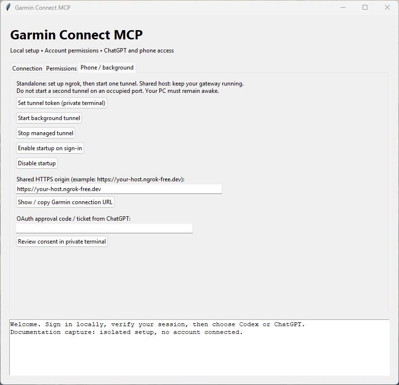

# Personal HTTPS access

[Documentation home](../README.md)

The optional remote service exposes the read tools and previewed account writes through
Streamable HTTP at `/mcp/garmin-connect/`. It requires OAuth with PKCE and explicit approval in
the owner's local terminal. Garmin credentials never go to ChatGPT or ngrok.
Ngrok carries the HTTPS traffic, including tool responses, so it is a trusted
transport provider. Your PC and the tunnel process must remain running.

## Choose one hosting mode

- **Garmin only:** start one standalone tunnel using the instructions below.
- **Multiple MCP servers on one hostname:** keep one tunnel to your gateway and
  route each service by path. Follow [shared hosting](shared-hosting.md); do not
  start Garmin's standalone tunnel as well.



*Actual 0.19.0 Windows setup UI; the hostname is an example, no account is connected.*
Enter the HTTPS origin in **Phone / background**, then choose **Show / copy Garmin
connection URL**. It copies the full `/mcp/garmin-connect/` URL. This helper does
not start or configure a gateway.

## Install and start (Windows)

Install with remote dependencies first (`scripts/install.ps1 -Remote`, optionally `-Desktop`). Then run from any directory:

```powershell
$Garmin = Join-Path $env:LOCALAPPDATA 'Programs\GarminConnectMCP\bin\garmin-connect.ps1'
& $Garmin verify
& $Garmin tunnel-setup
& $Garmin tunnel
```

On Linux, install with `--remote`, then use the absolute installed launcher with the same commands. For a background tunnel use `background-start`; startup registration is separately opt-in. See [installation](installation.md#optional-background-operation).

Setup prompts for the ngrok authtoken without echoing it. Tokens and remote
OAuth state use Windows account encryption in the existing private data
directory. The launcher reserves a loopback socket before opening the tunnel.
It prints the public MCP URL; `tunnel-status` also reports the URL and process ID.
Ctrl+C closes the foreground server and tunnel. No startup task is installed.

The expected new connection URL is `https://YOUR-HOST/mcp/garmin-connect/`.
Run `connection-info --public-url https://YOUR-HOST` to print the exact public
URLs without accessing Garmin or exposing credentials.

## Connect ChatGPT

In the web app, open the custom MCP connection setup (the tested interface was at https://chatgpt.com/plugins), then Add custom MCP server. UI names and availability can change;
and enter the printed HTTPS URL. Select OAuth, then Dynamic Client Registration
(DCR); leave static client ID and secret blank, and keep `garmin:read` selected.
Use the name **Garmin Connect**. For writes (locally enabled by default), also select `garmin:write`.
New DCR registrations that omit scope support both scopes, but tokens receive
only the scopes approved through local consent. Explicit read-only registrations
remain read-only. If authorization reports that the client was not registered
with `garmin:write`, delete that ChatGPT connection and create a fresh one with
both scopes selected; reconnecting the old client does not change its registration.
The CIMD-unavailable notice is informational; this server supports DCR.
Create the plugin and install it. Availability
depends on your account and workspace. When the connection opens its consent
page, paste the entire approval command shown there into PowerShell on the PC
running the server. It uses that installation's absolute Python path and works
from any folder, without activating a virtual environment. Then
review the callback and type `APPROVE`. Return to the page and select Continue.
Only ChatGPT callback URLs are permitted. Connection requests expire after five
minutes; restart authorization if needed.

After installation, verify access in a new ChatGPT conversation, then check the
app on your phone. Phone availability must be checked with your account; a
successful local test does not establish mobile support.

### Verify the connection

After installing the plugin, start a fresh chat and ask for the connector's
version and tool capabilities, then a bounded read such as yesterday's sleep.
Do not use a write as a connectivity test. If only discovery succeeds, Garmin
session verification is still a separate check.

The current official [custom MCP setup guide](https://developers.openai.com/api/docs/guides/custom-mcp-server)
describes the Plugins screen and account availability. Open **Plugins**, choose
**Add custom MCP server**, enter the full server URL and OAuth/DCR, create the
plugin, then install it. UI labels and workspace availability can change.

### Existing connections when upgrading

An existing `/mcp` connection keeps its old OAuth identity and grants. Version
0.19.0 retains the legacy routes when their saved state exists. To adopt the new
URL, create a **new** ChatGPT connection and approve its requested scopes locally.
Do not change an old connection's URL and reuse its token. After verifying the
new connection, remove the old one in ChatGPT. `remote-serve --no-legacy-root`
can disable the old public routes without deleting saved grants.

## Revoke and troubleshoot

```powershell
# Use the Python path from your installation.json receipt.
& '<absolute installed python path>' -m garmin_connect_mcp.remote reset
```

Type `RESET` to revoke all remote tokens and registrations. This preserves the
local Garmin login. Stop the tunnel process to disable public access entirely.
If ngrok assigns a different origin, reset remote state and reconnect ChatGPT.
The server rejects origin changes instead of moving existing grants silently.

Unauthorized `/mcp` requests return 401. Public health and OAuth metadata reveal
no Garmin data. Access tokens expire after an hour; rotated refresh tokens have
a 30-day lifetime. MCP requests have a 3 MiB HTTP body limit (activity-file payloads are limited to
2 MiB decoded); OAuth requests have a 16 KiB limit. Bounded concurrency and a
shared 120-per-minute limit apply. Access logging is disabled. This is a single-owner
service, not a multi-user public Garmin integration.

Offline tests cover discovery, local consent, PKCE, code replay, resource binding,
refresh rotation, revocation, expiry and HTTP boundary checks. Public tunnel and
ChatGPT connection checks require the owner's ngrok token and account.

## Troubleshooting HTTPS inspection

If antivirus HTTPS inspection replaces ngrok certificates or damages HTTP
response framing, use narrowly scoped Web Shield exceptions for the ngrok
agent hostname, your assigned public hostname and your loopback port.
Keep antivirus protection and TLS certificate validation enabled.


## Account writes

See [account writes](../guides/account-writes.md). If an existing local policy disabled writes, re-enable them locally; refresh the ChatGPT tool list,
and reconnect with both garmin:read and garmin:write. Existing read-only tokens
are not upgraded. Review every draft before commit.

## Server updates and safety-block diagnosis

Restart the HTTPS service after server-code updates and verify the printed origin
matches the registered ChatGPT URL. Keep existing encrypted sessions/grants; an
ordinary update does not require resetting OAuth. Refresh/review the plugin's
saved tool definitions when they change. Existing read-only clients still need
explicit write authorization; refreshing tools alone does not expand scopes.

Version 0.8.0 returns copy-ready operation-specific commit arguments from workout
preparation. Approve the full preview and pass those arguments unchanged. If
ChatGPT says a call was blocked by OpenAI safety checks without a server response,
preserve the exact message and inspect durable draft status. A working direct
MCP diagnostic does not establish that ChatGPT's classifier will permit a call.
Do not switch execution paths to evade a platform block. The owner reported
success after the 0.8.0 update; this is one case, not a guaranteed remedy.

## Installed launchers

[installation](installation.md) provides Windows/Linux per-user setup. Include remote
extras, then use the full launcher path with `tunnel-setup`, `tunnel` and
`approve <ticket>` instead of activating Python or changing directories.
The current HTTPS process and credentials are not moved by installation.
Linux session files use owner-only permissions by default, with optional Secret Service encryption; see [permissions and storage](../guides/permissions-and-storage.md).
