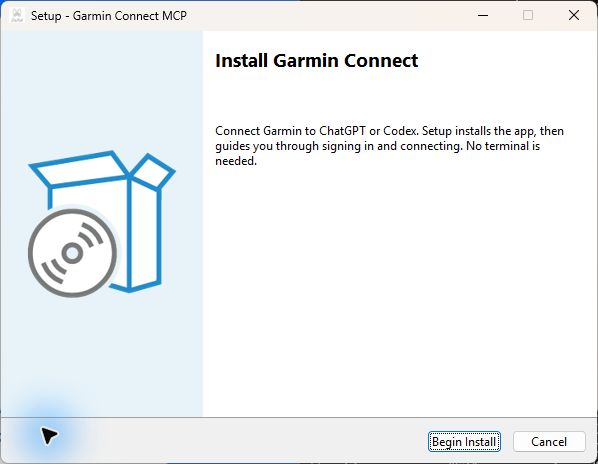

# Install Garmin Connect

## 1. Download

**[Download the Windows installer](https://github.com/myke239/garmin-connect-mcp/releases/latest/download/GarminConnectSetup.exe)**

Windows 10/11, x64. No Python, Git or terminal is needed. The installer is currently unsigned.

[Linux or macOS](unix.md) · [Advanced installation](advanced-installation.md)

## 2. Run

Open **GarminConnectSetup.exe** and select **Begin Install**.
The app installs and opens the setup wizard automatically.

## 3. Follow the wizard

| Page | What to enter or do |
| --- | --- |
| Garmin sign-in | Your Garmin email, password and verification code. |
| Choose your app | Select ChatGPT or Codex. |
| ChatGPT connection | Paste your ngrok authtoken, or enter your existing HTTPS address. |
| Add Garmin | The wizard copies the URL and opens ChatGPT. Select **Add custom MCP server**, then **OAuth / Dynamic Client Registration**. |
| Approve | Copy the browser's connection code into the wizard. Review access and select **Approve connection**. |
| Verify | Finish installing the plugin in ChatGPT, then select **Verify connection** in the wizard. |

Codex users select **Connect Codex** instead of the ChatGPT steps.

## 4. Check success

The wizard shows **You're connected**, with checks for Garmin, the tools and your chosen app.
Open a new chat and ask: **“Summarize my last three activities.”**

[Need help?](../guides/troubleshooting.md)
